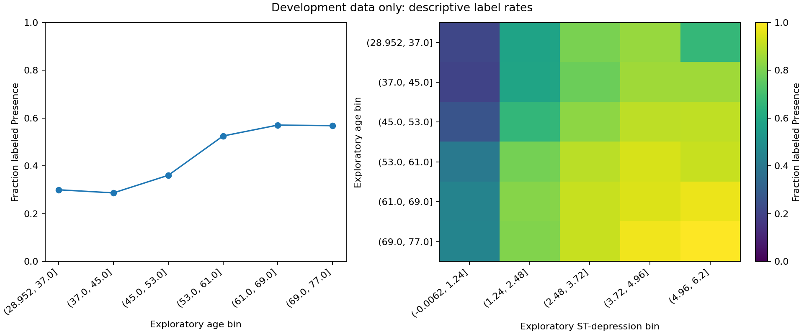
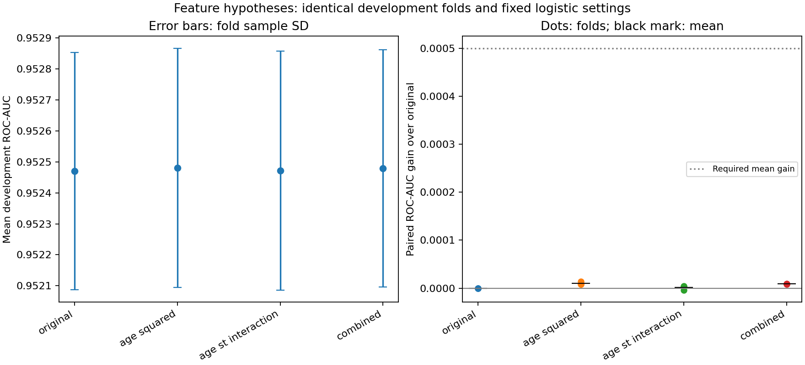

# Feature engineering: development experiments

These are development-only selection experiments. The final holdout and test.csv were not evaluated.

## Predeclared hypotheses and protocol

The original logistic baseline is compared with Age squared, Age times ST depression, and both terms together. These test curvature and an interaction in the log-odds; they are not clinical formulas or causal claims. Candidates and the retention rule were saved before examining their scores.

Every engineered variant first fits numeric median imputation on its training fold, creates the specified terms from those imputed values, and fits standard scaling on that fold. Categorical mode imputation and one-hot encoding also stay inside the fold. Original raw feature roles, IDs, labels, saved split, folds, C=1.0, max_iter=1000, seed 42, and threshold 0.5 remain fixed. No parameter search was performed.

The predeclared retention rule requires mean ROC-AUC gain of at least 0.0005, positive gain in every fold, and no convergence warnings. Otherwise the original feature set is retained. This is a practical course-project rule, not a statistical test.

Development rows: 504000; holdout rows excluded: 126000.

## Development exploration

The plots describe age and age/ST-depression label-rate patterns in the development pool. Their bins are exploratory and never used as model inputs. Such associations can reflect other predictors; they do not establish a causal effect or prove an engineered term will help.

## Complete comparison

| Feature set | Status | Mean ROC-AUC | Fold SD | Mean gain | Accuracy | Recall |
| --- | --- | ---: | ---: | ---: | ---: | ---: |
| original | completed | 0.952470 | 0.000383 | +0.000000 | 0.884966 | 0.859287 |
| age_squared | completed | 0.952480 | 0.000386 | +0.000010 | 0.885040 | 0.859433 |
| age_st_interaction | completed | 0.952472 | 0.000386 | +0.000002 | 0.884966 | 0.859309 |
| combined | completed | 0.952479 | 0.000384 | +0.000009 | 0.885038 | 0.859419 |

Values are proportions, not percentages. Scores are unweighted means across the same three folds. Fold SD is not a confidence interval; paired gains compare corresponding folds. All weak/negative and failed outcomes are retained in the full reference JSON and comparison CSV.

## Development recommendation

Recommended feature set under the frozen rule: **original**. Highest mean ROC-AUC: **age_squared**.

These scores were used to compare feature sets and may be optimistic as selection estimates. The eventual selected method still needs the untouched final holdout after remaining project choices are frozen. No clinical-validity or statistical-significance claim follows from this experiment.

## Reproduction and traceability

[Full reference record](feature_engineering_reference.json) includes every candidate, paired gains, plan, data/split hashes, environment and source fingerprint. Individual runs retain fold CSVs, development predictions, warnings, and complete development-trained pipelines. Failed runs retain their errors.

Run the feature_experiments command in the README using a new output directory. The original baselines and experiment inputs are preserved.

## Verification of this reference run

All 36 synthetic tests passed. The original control produced byte-identical development predictions to the published logistic baseline. A fresh-container repeat of Age squared produced identical metric summaries and byte-identical predictions. [Verification record](feature_engineering_verification.json) retains the hashes and tested image ID. [Exploration values](feature_engineering_eda.json) retain the plotted development summaries.

The best mean gain was approximately 0.000010 for Age squared, positive in all three folds but below the predeclared 0.0005 retention threshold. The interaction worsened one fold. No fit produced a convergence warning. These results support retaining the original features under this fixed protocol; they do not show that feature engineering cannot help other models or configurations.
